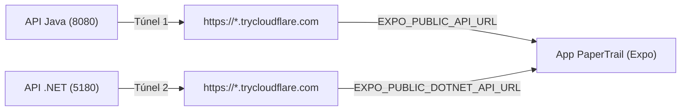

# PaperTrail — Mobile Application

> **FIAP Global Solution 2026/2 — CitizenTech**  
> Aplicativo mobile desenvolvido em **React Native + Expo**, integrado a APIs Java Spring Boot e ASP.NET Core (.NET), projetado para auxiliar cidadãos na preparação completa para atendimentos em serviços públicos, centralizando requisitos oficiais, esclarecimento de dúvidas com IA contextual e listas de verificação (checklists) dinâmicas.

---

## Sumário
- [Resumo do Projeto](#resumo-do-projeto)
- [Tecnologias Utilizadas](#tecnologias-utilizadas)
- [Vídeo de Demonstração](#vídeo-de-demonstração)
- [Credenciais para Teste e Avaliação](#credenciais-para-teste-e-avaliação)
- [Execução Rápida (com APIs publicadas na Azure)](#execução-rápida-com-apis-publicadas-na-azure)
- [Integração e Repositórios dos Backends](#integração-e-repositórios-dos-backends)
  - [API Java Spring Boot (Identidade, Catálogo, Requisitos e Orientação IA)](#1-api-java-spring-boot-identidade-catálogo-requisitos-e-orientação-ia)
  - [API .NET ASP.NET Core (Preparativos, Checklist e Progresso)](#2-api-net-aspnet-core-preparativos-checklist-e-progresso)
  - [Inteligência Artificial e Arquiteturas Disruptivas (Spring AI / RAG Contextual)](#3-inteligência-artificial-e-arquiteturas-disruptivas-spring-ai--rag-contextual)
- [Solução do Projeto e Funcionalidades](#solução-do-projeto-e-funcionalidades)
  - [Detalhamento de Telas e Endpoints](#detalhamento-de-telas-e-endpoints)
- [Execução em Ambiente Local (Opcional)](#execução-em-ambiente-local-opcional)
  - [Inicialização Tradicional (Wi-Fi Local ou Emulador)](#1-inicialização-tradicional-wi-fi-local-ou-emulador)
  - [Inicialização com Túneis Cloudflare (End-to-End Remoto)](#2-inicialização-com-túneis-cloudflare-end-to-end-remoto)
- [Arquitetura e Estrutura de Pastas](#arquitetura-e-estrutura-de-pastas)
- [Diagnóstico e Comandos Úteis](#diagnóstico-e-comandos-úteis)
- [Integrantes da Equipe](#integrantes-da-equipe)

---

## Resumo do Projeto

O **PaperTrail** é uma plataforma concebida para transformar a forma como o cidadão se prepara para acessar serviços públicos. A proposta central é eliminar o retrabalho, as filas desnecessárias e os deslocamentos perdidos causados pela falta de documentos ou informações prévias.

O aplicativo funciona como cliente consumidor de duas APIs independentes e distribuídas:
1. **API Java (Spring Boot):** Gerencia a identidade do cidadão (autenticação JWT), catálogo oficial de serviços públicos categorizados, requisitos regulamentares e a orquestração do módulo de inteligência artificial generativa contextual (Spring AI / RAG).
2. **API .NET (ASP.NET Core):** Implementada sob os princípios de Clean Architecture, gerencia o ciclo de vida dos preparativos pessoais do cidadão, clonando os requisitos em itens de checklist independentes, calculando o progresso em tempo real e garantindo a resiliência via chave de idempotência (`Idempotency-Key`).

O cidadão consulta serviços, analisa os requisitos detalhados com as respectivas fontes e datas de revisão, esclarece dúvidas diretamente pelo módulo de IA contextual e gera seu checklist individual.

> [!IMPORTANT]
> **Limites de Responsabilidade do PaperTrail:**  
> - A conclusão de um checklist indica apenas que o cidadão marcou todos os itens obrigatórios estipulados na versão de referência; isso **não comprova validade documental, elegibilidade ou deferimento**.
> - O PaperTrail **não realiza agendamentos oficiais**, não substitui canais governamentais e a IA não altera autonomamente listas de tarefas nem emite decisões jurídicas.

---

## Tecnologias Utilizadas

### Mobile Application
- **Framework Core:** [React Native](https://reactnative.dev/) (0.88.1) & [Expo SDK 58](https://expo.dev/)
- **Linguagem:** [TypeScript](https://www.typescriptlang.org/) (~6.0)
- **Gerenciamento de Estado & Cache Assíncrono:** [TanStack Query v5 (`@tanstack/react-query`)](https://tanstack.com/query)
- **Cliente HTTP:** [Axios](https://axios-http.com/) (com interceptores para injeção automática de Bearer Token JWT e tratamento global de erros)
- **Roteamento & Navegação:** [React Navigation v7](https://reactnavigation.org/) (`@react-navigation/native-stack`) com barra de navegação inferior desacoplada
- **Persistência Local:** [AsyncStorage](https://react-native-async-storage.github.io/async-storage/) (gestão stateless de sessão e preferências de tema)
- **Estilização & UI:** [NativeWind v4](https://www.nativewind.dev/) (Tailwind CSS) com suporte completo e dinâmico aos modos Claro (*Light*) e Escuro (*Dark*)
- **Animações & Gestos:** [React Native Reanimated](https://docs.swmansion.com/react-native-reanimated/), [React Native Worklets](https://github.com/software-mansion/react-native-worklets) e [React Native Gesture Handler](https://docs.swmansion.com/react-native-gesture-handler/)
- **Ícones & Gráficos:** [Lucide React Native](https://lucide.dev/) e [React Native SVG](https://github.com/software-mansion/react-native-svg)
- **Build & Auditoria de Versão:** [Expo Constants](https://docs.expo.dev/versions/latest/sdk/constants/) com extração dinâmica do `commitHash` via `app.config.js`
- **Suporte Multiplataforma:** Android, iOS e Web ([React Native Web](https://necolas.github.io/react-native-web/))

### Ecossistema Backend & Infraestrutura
- **Backends:** Java 17 (Spring Boot 3.x) e .NET 9 (ASP.NET Core Minimal APIs / Clean Architecture)
- **Inteligência Artificial:** Spring AI integrado com recuperação contextual (RAG) baseada em trechos de fontes oficiais
- **Bancos de Dados:** Oracle Database (persistência relacional) e MongoDB (projeção documental para auditoria e consultas analíticas)
- **Mensageria:** RabbitMQ para notificação assíncrona de eventos (ex: sinalização de atualização de versões de serviços)
- **Cloud Hosting:** Microsoft Azure App Services
- **Túneis de Desenvolvimento:** Cloudflare Tunnel (`cloudflared`)

---

## Vídeo de Demonstração

> **Link do Vídeo no YouTube:** [Assista à demonstração do PaperTrail no YouTube]() *(Link da demonstração)*

> *Apresentação completa das 8 telas da aplicação em dispositivo físico, autenticação segura com JWT, consulta paginada ao catálogo com filtros por categoria, esclarecimento de dúvidas com IA contextual com fontes oficiais, criação de preparativo com chave idempotente, manipulação de checklist com atualização de progresso, alternância de tema Claro/Escuro e auditoria do commit na tela Sobre.*

---

## Credenciais para Teste e Avaliação

Para facilitar a homologação e avaliação imediata da banca examinadora, utilize a conta de testes pré-configurada ou crie um novo acesso instantâneo:

| Campo | Valor Sugerido / Conta Padrão |
| :--- | :--- |
| **E-mail:** | `teste@gmail.com` *(ou cadastre qualquer e-mail válido)* |
| **Senha:** | `senha123` |

> [!NOTE]
> **Fluxo de Novo Cadastro:** Caso prefira cadastrar um novo cidadão, toque em **"Cadastre-se"** na tela de Login. A requisição será processada pela API Java (`POST /auth/register`), que registra a credencial com hash seguro BCrypt, emite o JWT e realiza o login automático, salvando o token de forma segura no `AsyncStorage`.

---

## Execução Rápida (com APIs publicadas na Azure)

As APIs Java e .NET estão publicadas e operacionais no Azure App Services com bancos de dados conectados. **Não é necessário rodar nenhum backend localmente para testar e avaliar o aplicativo.**

### 1. Clonar e Instalar Dependências
```bash
git clone https://github.com/Paper-Trail-GS-2026/Paper-Trial.git
cd Paper-Trial
npm install
```

### 2. Configurar o Arquivo de Ambiente
Crie o arquivo `.env` a partir do modelo pré-configurado:
```bash
cp .env.example .env
```

O arquivo `.env` deve apontar para os endereços oficiais do Azure:
```env
EXPO_PUBLIC_API_URL=https://papertrail-java-rm561584.azurewebsites.net
EXPO_PUBLIC_DOTNET_API_URL=https://papertrail-dotnet-rm561584.azurewebsites.net
```

> [!IMPORTANT]
> As variáveis `EXPO_PUBLIC_*` devem conter apenas a URL base do host (sem barra final ou sufixo `/api`), pois os clientes Axios internos gerenciam as rotas e os parâmetros.

### 3. Iniciar o Aplicativo
```bash
npx expo start -c
```
- Abra o aplicativo **Expo Go** em seu dispositivo físico (Android ou iOS) e leia o QR Code exibido no terminal.
- Ou pressione `a` para abrir no Emulador Android, `i` para simulador iOS ou `w` para testar no navegador.

> [!TIP]
> **Documentação Interativa das APIs:**
> - [Swagger da API Java (Azure)](https://papertrail-java-rm561584.azurewebsites.net/swagger-ui/index.html)
> - [Swagger da API .NET (Azure)](https://papertrail-dotnet-rm561584.azurewebsites.net/swagger)

---

## Integração e Repositórios dos Backends

### 1. API Java Spring Boot (Identidade, Catálogo, Requisitos e Orientação IA)
- **Repositório:** [Paper-Trail-GS-2026/Java-Advanced-Paper-Trial](https://github.com/Paper-Trail-GS-2026/Java-Advanced-Paper-Trial)
- **Tecnologias:** Java 17, Spring Boot 3.x, Spring Data JPA / Hibernate, Spring Security, Spring AI, Flyway e Oracle Database.
- **Responsabilidades:** Autenticação e perfil do cidadão (`POST /auth/register`, `POST /auth/login`, `GET /auth/me`), catálogo de categorias e serviços públicos com paginação e ordenação, geração do snapshot imutável de requisitos (`/services/{id}/requirements-snapshot`) e processamento de perguntas com IA fundamentada em evidências.
- **Segurança:** Autenticação stateless baseada em tokens JWT e criptografia de credenciais com BCrypt.

### 2. API .NET ASP.NET Core (Preparativos, Checklist e Progresso)
- **Repositório:** [Paper-Trail-GS-2026/.Net-Paper-Trial](https://github.com/Paper-Trail-GS-2026/.Net-Paper-Trial)
- **Tecnologias:** .NET 9 (C#), ASP.NET Core Minimal APIs, Clean Architecture, Entity Framework Core, Oracle Database e MongoDB.
- **Responsabilidades:** Gerenciamento dos preparativos pessoais do cidadão (`/preparativos/`), preservação da versão histórica dos requisitos no ato de criação, persistência de itens do checklist, alternância de estado (pendente/concluído) e cálculo analítico de progresso (`/progresso`).
- **Resiliência:** Suporte a cabeçalho `Idempotency-Key` na criação de preparativos, evitando duplicidades em cenários de instabilidade de rede.

### 3. Inteligência Artificial e Arquiteturas Disruptivas (Spring AI / RAG Contextual)
- **Repositório:** [Paper-Trail-GS-2026/Disruptive-Architectures-Paper-Trial](https://github.com/Paper-Trail-GS-2026/Disruptive-Architectures-Paper-Trial)
- **Tecnologias:** Modelos de Linguagem Generativos, Spring AI e RAG (*Retrieval-Augmented Generation*).
- **Responsabilidades:** Recuperação semântica de trechos normativos previamente cadastrados e revisados para responder dúvidas dos cidadãos sobre um serviço específico.
- **Governança:** Caso a documentação disponível não contenha subsídios suficientes, a IA sinaliza expressamente a insuficiência de evidências (`insufficientEvidence: true`) com indicação das fontes consultadas, sem alucinações de requisitos inexistentes.

---

## Solução do Projeto e Funcionalidades

O **PaperTrail** entrega uma experiência fluida para guiar o cidadão da descoberta do serviço à conclusão de sua preparação:

1. **Autenticação Segura & Sessão:** Login stateless com armazenamento de token JWT em `AsyncStorage`, restauração automática de sessão ao reabrir o app, renovação transparente e interceptores Axios com deslogue automático em caso de expiração (HTTP 401).
2. **Catálogo de Serviços Públicos:** Listagem com suporte a paginação assíncrona, filtragem por categorias governamentais (ex: Documentos Pessoais, Saúde, Trabalho) e barra de pesquisa dinâmica.
3. **Detalhamento do Serviço & Requisitos:** Exibição da versão do serviço, requisitos obrigatórios/opcionais, prazos e fontes oficiais com links diretos e datas de revisão.
4. **Orientação Contextual com IA (Perguntas & Respostas):** O cidadão digita sua dúvida sobre o serviço selecionado e recebe respostas fundamentadas com indicação transparente das fontes oficiais consultadas.
5. **Criação de Preparativo Pessoal (com Idempotência):** Transforma os requisitos do serviço em uma lista de tarefas individual. Utiliza chave idempotente única por tentativa, prevenindo registros repetidos em quedas de sinal.
6. **Checklist Interativo & Progresso em Tempo Real:** Marcação rápida de pendências com sincronização imediata na API .NET (`PATCH /estado`), exibição de percentual de conclusão e indicador visual de prontidão (*Ready*).
7. **Sinalização de Desatualização (*Source Outdated*):** Caso os órgãos públicos publiquem alterações no serviço original, o preparativo existente avisa ao cidadão que há novas diretrizes sem apagar suas anotações anteriores.
8. **Edição e Exclusão Segura:** Renomeação rápida de preparativos e exclusão com modal de confirmação e bloqueio de cliques durante o processamento.
9. **Preferências e Temas:** Alternância dinâmica de tema entre Claro (*Light*) e Escuro (*Dark*), persistida localmente.
10. **Sobre o App e Auditoria de Versão:** Tela informativa contendo dados da equipe, integrantes, proposta acadêmica e o hash Git extraído em tempo de build (`commitHash` via `app.config.js`).

### Detalhamento de Telas e Endpoints

```text
Fluxo Não Autenticado:
├── LoginScreen                 -> POST /auth/login (Autenticação JWT)
└── RegisterScreen              -> POST /auth/register (Cadastro do cidadão com validação)

Fluxo Autenticado (Protegido por Sessão e Interceptores JWT):
├── HomeScreen                  -> GET /services (Recentes) | GET /preparativos/ (Em andamento)
├── ServicesScreen (Catálogo)   -> GET /categories (Java) | GET /services (Java, paginado)
├── ServiceDetailsScreen        -> GET /services/{id} (Java)
│                               -> GET /services/{id}/requirements-snapshot (Java)
│                               -> POST /services/{id}/guidance (Spring AI / RAG)
│                               -> POST /preparativos/ (.NET, criação com Idempotency-Key)
├── PreparationsScreen (Lista)  -> GET /preparativos/ (.NET, listagem paginada)
├── PreparationDetailsScreen    -> GET /preparativos/{id} (.NET)
│                               -> GET /preparativos/{id}/itens (.NET, checklist)
│                               -> PATCH /preparativos/{id}/itens/{itemId}/estado (.NET)
│                               -> GET /preparativos/{id}/progresso (.NET, taxa de conclusão)
│                               -> PUT /preparativos/{id} (.NET, renomeação)
│                               -> DELETE /preparativos/{id} (.NET, exclusão)
├── ProfileScreen               -> GET /auth/me (Java) | Alternância de Tema | Logout seguro
└── AboutScreen                 -> Exibição da versão, commit hash da build e dados da equipe
```

---

## Execução em Ambiente Local (Opcional)

Caso deseje executar os backends Java e .NET em sua própria máquina de desenvolvimento:

### 1. Inicialização Tradicional (Wi-Fi Local ou Emulador)

#### A. Emulador Android Studio (mesma máquina)
Configure o `.env`:
```env
EXPO_PUBLIC_API_URL=http://10.0.2.2:8080
EXPO_PUBLIC_DOTNET_API_URL=http://10.0.2.2:5180
```

#### B. Dispositivo Físico (mesma rede Wi-Fi)
1. Descubra o IP local do seu computador na rede:
   ```bash
   # Linux / macOS:
   ip route get 1.1.1.1 | awk '{print $7}'
   # Windows:
   ipconfig
   ```
2. Configure o `.env` com o seu IP:
   ```env
   EXPO_PUBLIC_API_URL=http://<SEU_IP_LOCAL>:8080
   EXPO_PUBLIC_DOTNET_API_URL=http://<SEU_IP_LOCAL>:5180
   ```
3. Inicie o Expo:
   ```bash
   npx expo start -c
   ```

---

### 2. Inicialização com Túneis Cloudflare (End-to-End Remoto)

Ideal para rodar no smartphone físico via 4G/5G ou em redes universitárias/corporativas com isolamento de clientes (*Client Isolation*), sem restrições de firewall.



1. **Subir API Java:**
   ```bash
   cd ../Java-Advanced-Paper-Trial
   ./mvnw spring-boot:run
   ```
2. **Subir Túnel para Java:**
   ```bash
   cloudflared tunnel --url http://localhost:8080
   ```
3. **Subir API .NET:**
   ```bash
   cd ../.Net-Paper-Trial
   dotnet run
   ```
4. **Subir Túnel para .NET:**
   ```bash
   cloudflared tunnel --url http://localhost:5180
   ```
5. **Configurar o `.env` do PaperTrail:**
   ```env
   EXPO_PUBLIC_API_URL=https://tunel-java.trycloudflare.com
   EXPO_PUBLIC_DOTNET_API_URL=https://tunel-dotnet.trycloudflare.com
   ```
6. **Iniciar o Expo:**
   ```bash
   npx expo start -c
   ```

---

## Arquitetura e Estrutura de Pastas

O projeto adota uma arquitetura modular por camadas, com separação estrita entre navegação, serviços de rede, regras de negócio e componentes de interface:

```text
Paper-Trial/
├── App.tsx                     # Ponto de entrada com Providers (QueryClient, AuthProvider, ThemeProvider)
├── app.config.js               # Configuração dinâmica do Expo (captura de Git Commit Hash e metadados)
├── app.json                    # Manifesto do aplicativo Expo
├── assets/                     # Recursos gráficos e ícones estáticos
├── global.css                  # Folha de estilos raiz com utilitários NativeWind
├── tailwind.config.js          # Configuração de temas, paleta de cores e tipografia
├── src/
│   ├── Components/             # Componentes visuais modulares e reutilizáveis
│   │   ├── AboutScreenComponents/        # Cartões de auditoria e informações da equipe
│   │   ├── HomeScreenComponents/         # Seção de boas-vindas, atalhos rápidos e resumo
│   │   ├── LoginScreenComponents/        # Formulário de acesso e recuperação
│   │   ├── PreparationsScreenComponents/ # Lista de preparativos e cards de progresso
│   │   ├── PrepDetailScreenComponents/   # Seletor de checklist, filtros e indicador de prontidão
│   │   ├── ProfileScreenComponents/      # Detalhes da conta, seletor de tema e ação de logout
│   │   ├── RegisterScreenComponents/     # Formulário de cadastro com validação de campos
│   │   ├── ServiceDetailScreenComponents/# Snapshot de requisitos e widget de perguntas IA
│   │   └── ServicesScreenComponents/     # Barra de busca e seletor de categorias
│   ├── Config/                 # Configuração centralizada de variáveis de ambiente (env.ts)
│   ├── Context/                # Contextos globais (AuthContext para sessão e ThemeContext para tema)
│   ├── Data/                   # Metadados e dados institucionais (AppInfo, DevelopersData)
│   ├── Hooks/                  # Custom Hooks desacoplando mutações e formulários da UI
│   ├── Lib/                    # Configuração do QueryClient e chaves de invalidação de cache
│   ├── Navigation/             # Sistema de rotas tipadas (AppNavigator) e BottomNavigation
│   ├── Screens/                # Telas da aplicação (Login, Register, Home, Services, Prep, etc.)
│   ├── Services/               # Clientes HTTP Axios (auth, services, preparations, checklist, guidance)
│   ├── Types/                  # Tipagens TypeScript estritas (DTOs, Entidades, Enums e Navegação)
│   └── Utils/                  # Validadores de senha/email e formatadores de progresso
├── .env.example                # Modelo oficial de variáveis de ambiente
└── package.json                # Dependências e scripts do ecossistema
```

---

## Diagnóstico e Comandos Úteis

| Ação | Comando ou Verificação |
| :--- | :--- |
| **Instalar dependências** | `npm install` |
| **Iniciar Expo com cache limpo** | `npx expo start -c` |
| **Iniciar Expo com túnel** | `npx expo start -c --tunnel` |
| **Executar na Web** | `npm run web` *(ou `npx expo start --web`)* |
| **Executar no Android** | `npm run android` |
| **Executar no iOS** | `npm run ios` |
| **Checagem estática de tipos** | `npx tsc --noEmit` |
| **Conferir o commit hash atual** | `git rev-parse --short HEAD` |
| **Health Check API Java (Azure)** | `curl -i https://papertrail-java-rm561584.azurewebsites.net/swagger-ui/index.html` |
| **Health Check API .NET (Azure)** | `curl -i https://papertrail-dotnet-rm561584.azurewebsites.net/swagger` |
| **Testar listagem de categorias (Java)** | `curl -i https://papertrail-java-rm561584.azurewebsites.net/categories` |
| **Testar listagem de serviços (Java)** | `curl -i https://papertrail-java-rm561584.azurewebsites.net/services` |
| **Testar login via terminal (Java)** | `curl -i -X POST https://papertrail-java-rm561584.azurewebsites.net/auth/login -H "Content-Type: application/json" -d '{"email":"cidadao@papertrail.com","password":"senha123"}'` |
| **Verificar processos locais ativos** | `ps aux \| grep -E "cloudflared\|expo\|java\|dotnet"` |

---

## Integrantes da Equipe

| Foto | Nome do Aluno | RM | Perfil |
| :---: | :--- | :---: | :---: |
|  | **André Emygdio Ferreira** | *RM565592* | [@AndreEmygdio](https://github.com/AndreEmygdio) |
|  | **Gabriel Lourenço Martins** | *RM562194* | [@glmartins2004](https://github.com/glmartins2004) |
|  | **Giovane Amato dos Santos** | *RM561336* | [@ruralgiovane](https://github.com/ruralgiovane) |
|  | **Matheus Roque Arantes** | *RM561959* | [@matheusroquearantes](https://github.com/matheusroquearantes) |
|  | **Orlando Gonçalves de Arruda** | *RM561584* | [@Orlando-Arruda](https://github.com/Orlando-Arruda) |
